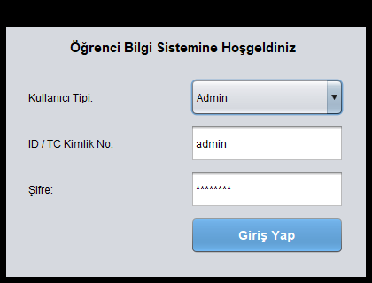
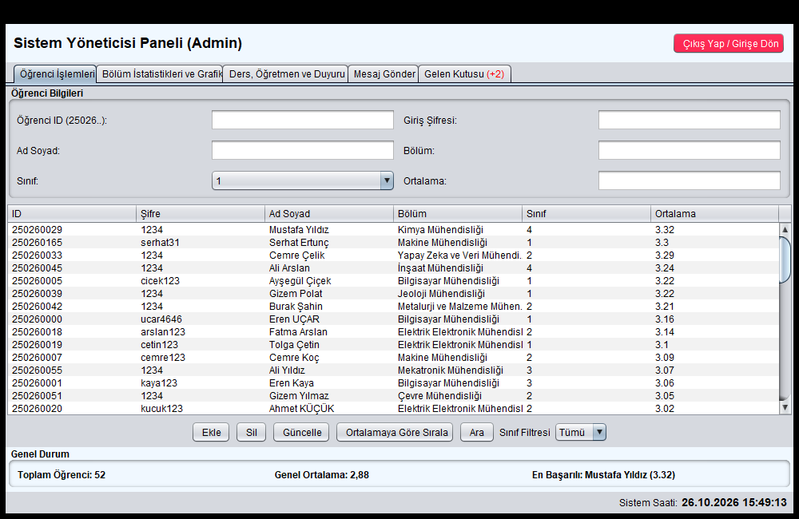
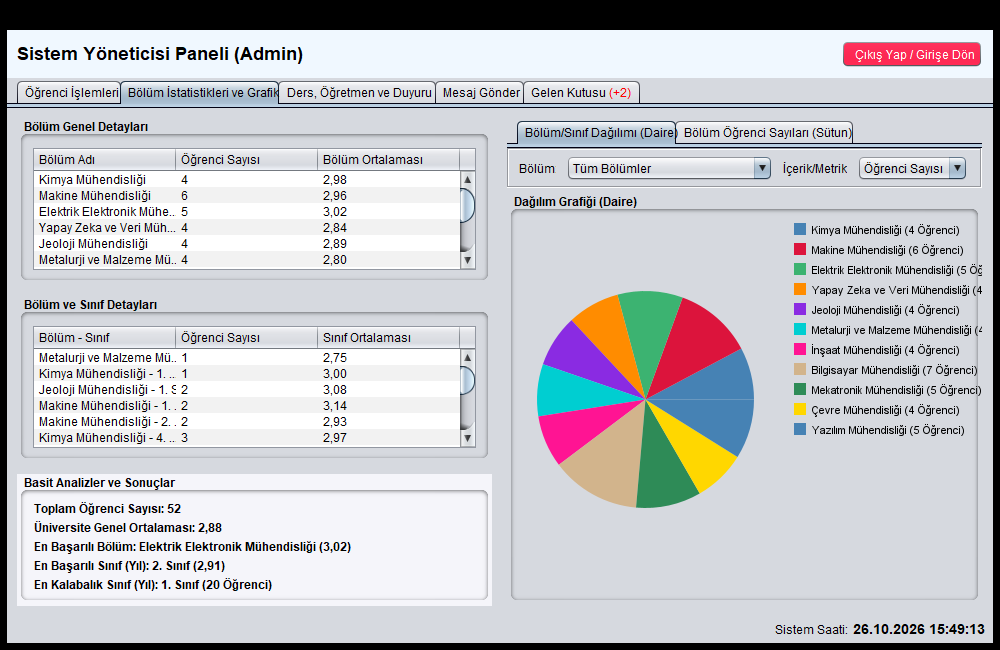
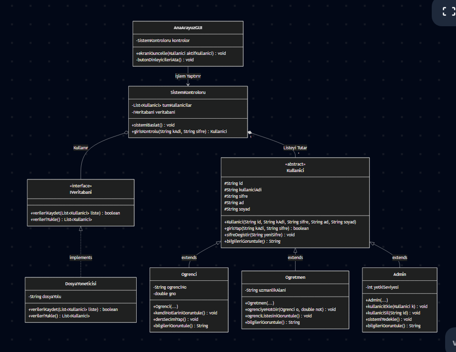

# 🎓 Öğrenci Yönetim ve Bilgi Sistemi (OBS)

Modern, güvenilir ve modüler bir mimariyle geliştirilmiş; **Öğrenci**, **Öğretim Elemanı** ve **Admin (Sistem Yöneticisi)** rollerini destekleyen masaüstü **Öğrenci Yönetim ve Bilgi Sistemi**.

Proje, verileri metin (.txt/.dat) dosyalarından **SQLite ilişkisel veritabanı (RDBMS)** mimarisine taşınmış, JDBC sürücüsü ile optimize edilmiş tam teşekküllü bir Java masaüstü uygulamasıdır.

---

## 🌟 Öne Çıkan Özellikler

### 🛡️ 1. Sistem Yöneticisi (Admin) Paneli
- **Öğrenci Yönetimi (CRUD):** Öğrenci ekleme, silme, güncelleme, ada veya numaraya göre anlık arama.
- **Filtreleme & Sıralama:** Sınıf bazında (1, 2, 3, 4. sınıf) filtreleme ve GPA'ya (not ortalaması) göre sıralama.
- **İstatistik & Raporlama:** Üniversite genel ortalaması, en başarılı bölüm, en kalabalık sınıf bilgileri.
- **Görsel Grafikler (AWT Graphics2D):**
  - **Daire (Pie) Grafiği:** Bölüm veya sınıf bazlı öğrenci/not dağılımı.
  - **Sütun (Bar) Grafiği:** Bölümlere göre öğrenci yoğunluğu.
- **Akademik Yönetim:**
  - Öğrencilere ders kaydı açma ve ders atama.
  - Yeni öğretim elemanı ve ders tanımlama.
  - Genel veya bölüm bazlı sistem duyurusu yayınlama.
- **İletişim & Destek:** Öğretmen ve öğrencilere mesaj gönderme, gelen destek bildirimlerini görüntüleme.
- **Canlı Sistem Saati:** Arka planda çalışan thread ile anlık tarih/saat takibi.

---

### 👨‍🏫 2. Öğretim Elemanı Paneli
- **Dinamik Not Girişi:** Vize ve final notlarını girme; sistem anında ortalamayı ve harf notunu (`AA`, `BA`, `BB`, `CB`, `CC`, `DC`, `FF`) otomatik hesaplar ve kaydeder.
- **Öğrenci GPA Güncellemesi:** Not girildiği anda öğrencinin genel not ortalaması (GPA) veritabanında otomatik yeniden hesaplanır.
- **Devamsızlık Takibi:** Öğrencilerin devamsızlık saatlerini kaydetme ve güncelleme.
- **Kişiselleştirilmiş Ders Programı:** Eğitmenin verdiği derslere göre oluşturulmuş haftalık gün, saat ve amfi programı.
- **Duyuru & Mesajlaşma:** Kendi bölümündeki öğrencilere duyuru geçme, öğrenci/öğretmenlere mesaj iletme.
- **Destek Sistemi:** Sistem yöneticisine doğrudan destek talebi iletme.

---

### 👨‍🎓 3. Öğrenci Paneli
- **Öğrenci Profili:** Kişisel bilgileri görüntüleme; T.C. kimlik, e-posta, telefon ve adres bilgilerini güncelleme.
- **Not Durum Belgesi:** Kayıtlı derslerin vize, final, harf notu ve devamsızlık durumuna bağlı başarı değerlendirmesi.
- **Devamsızlık Çizelgesi:** Yapılan devamsızlık saati, kalan hak (sınır: 8 saat) ve risk durumu (*İYİ*, *RİSKLİ*, *DEVAMSIZLIKTAN KALDI* / `DZ`).
- **Haftalık Ders Programı:** Bölüm ve sınıfa özel ders saatleri ve derslik (amfi) dağılımı.
- **Duyuru Panosu:** Üniversite geneli ve kayıtlı olunan bölüme ait tüm duyuruların anlık listesi.
- **Gelen Kutusu:** Öğretmenlerden ve sistem yöneticisinden gelen bildirimleri okuma.

---

## 🗄️ Veritabanı Mimarisi (SQLite)

Sistem, verileri yerel `ogrenci_sistemi.db` SQLite veritabanı dosyasında ilişkisel olarak saklar. İlk çalıştırmada tablolar otomatik oluşturulur ve geriye dönük veri kaybı yaşanmaması için mevcut kayıtlar otomatik olarak veritabanına aktarılır (Auto-Migration).

```
                      +-------------------+
                      |    ogrenciler     |
                      +-------------------+
                      | id (PK)           |
                      | sifre, ad, bolum  |
                      | sinif, ortalama   |
                      | eposta, tel, tc   |
                      +---------+---------+
                                |
             +------------------+------------------+
             | 1:N                                 | 1:N
             v                                     v
+------------------------+             +------------------------+
|         notlar         |             |      devamsizlik       |
+------------------------+             +------------------------+
| id (PK AUTO)           |             | id (PK AUTO)           |
| ogrenci_id (FK)        |             | ogrenci_id (FK)        |
| ders_adi               |             | ders_adi               |
| vize, final            |             | saat                   |
| UNIQUE(ogrenci, ders)  |             | UNIQUE(ogrenci, ders)  |
+------------------------+             +------------------------+
```

### Tablo Yapıları:
1. **`ogrenciler`**: Öğrenci ID, şifre, ad soyad, bölüm, sınıf, GPA ortalaması, iletişim ve adres bilgileri.
2. **`ogretmenler`**: T.C. Kimlik No (PK), şifre, unvan & ad soyad, verilen dersler.
3. **`dersler`**: Bölüm, sınıf yılı, ders adı, sorumlu öğretim üyesi.
4. **`notlar`**: Öğrenci ID, ders adı, vize, final notları.
5. **`devamsizlik`**: Öğrenci ID, ders adı, toplam devamsızlık saati.
6. **`mesajlar`**: Gönderen, alıcı, başlık, mesaj içeriği, gönderim tarihi.
7. **`duyurular`**: Hedef kitle (Genel / Bölüm Adı), duyuru içeriği, yayın tarihi.

---

## 🏗️ Proje Dizin Yapısı

```
Ogrenci-Yonetim-Sistemi/
├── lib/                             # Harici kütüphaneler (.jar)
│   ├── sqlite-jdbc-3.45.3.0.jar    # SQLite JDBC Veritabanı Sürücüsü
│   ├── slf4j-api-2.0.13.jar        # Loglama Arayüzü
│   └── slf4j-nop-2.0.13.jar        # Loglama Uygulaması
├── src/                             # Kaynak Kodlar
│   ├── admin/                      # Yönetici arayüz ve grafik panelleri
│   │   ├── AnaEkran.java
│   │   ├── AnaIslemlerPaneli.java
│   │   ├── DersYonetimPaneli.java
│   │   ├── IstatistikPaneli.java
│   │   ├── DaireGrafikPaneli.java
│   │   ├── SutunGrafikPaneli.java
│   │   ├── AdminMesajPaneli.java
│   │   └── AdminGelenKutusuPaneli.java
│   ├── app/                        # Ana giriş noktası
│   │   └── Main.java
│   ├── core/                       # İş mantığı ve yöneticiler
│   │   ├── OgrenciYonetici.java
│   │   ├── DataUpdateListener.java
│   │   └── OgrenciBulunamadiException.java
│   ├── database/                   # SQLite veritabanı bağlantı ve sorgu katmanı
│   │   └── DatabaseHelper.java
│   ├── model/                      # Varlık sınıfları (OOP)
│   │   ├── Kullanici.java
│   │   ├── KullaniciArayuzu.java
│   │   ├── Ogrenci.java
│   │   └── Ogretmen.java
│   ├── ogrenci/                    # Öğrenci paneli bileşenleri
│   │   ├── OgrenciEkrani.java
│   │   ├── OgrenciProfilPaneli.java
│   │   ├── OgrenciNotPaneli.java
│   │   ├── OgrenciDersProgramiPaneli.java
│   │   ├── OgrenciDevamsizlikPaneli.java
│   │   ├── OgrenciDuyuruPaneli.java
│   │   └── OgrenciGelenKutusuPaneli.java
│   ├── ogretmen/                   # Öğretim elemanı bileşenleri
│   │   ├── OgretmenEkrani.java
│   │   ├── NotGirisPaneli.java
│   │   ├── DevamsizlikGirisPaneli.java
│   │   ├── OgretmenMesajPaneli.java
│   │   └── OgretmenGelenKutusuPaneli.java
│   └── ortak/                      # Ortak paneller
│       └── DestekPaneli.java
├── ogrenci_sistemi.db               # İlk çalıştırmada otomatik oluşturulur
├── uml-diyagrami.png                # Proje UML Sınıf Diyagramı
├── *.txt / *.dat                    # SQLite için ilk çalıştırma tohum (seed) verileri
├── screenshots/                     # Uygulama ekran görüntüleri
│   ├── giris-ekrani.png
│   ├── admin-paneli.png
│   └── grafik-paneli.png
└── README.md                       # Proje Dokümantasyonu
```

---

## 📸 Ekran Görüntüleri

| Giriş Ekranı | Yönetici (Admin) Paneli |
|:---:|:---:|
|  |  |

<br>

<p align="center">
  <b>Bölüm İstatistikleri ve Dağılım Grafiği (AWT Graphics2D)</b><br>
  
</p>

### 📐 UML Sınıf Diyagramı



---

## 🚀 Kurulum ve Çalıştırma

### Gereksinimler
- **Java Development Kit (JDK):** JDK 17 veya üzeri (JDK 21 ve JDK 25 ile tam uyumludur).
- Herhangi bir harici SQL sunucusu (MySQL, XAMPP vb.) kurmanıza **gerek yoktur**. SQLite doğrudan proje içinde yerel dosya olarak çalışır.

### VS Code İle Çalıştırma
1. Projeyi Visual Studio Code ile açın.
2. `Extension Pack for Java` eklentisinin kurulu olduğundan emin olun.
3. `src/app/Main.java` dosyasını açıp sağ üstteki **Run Java** butonuna tıklayın.

### Terminal / Komut Satırı İle Derleme ve Çalıştırma

**Windows (PowerShell):**
```powershell
# 1. Projeyi derleyin
javac -cp "lib/*;src" -d bin (Get-ChildItem -Recurse -Filter *.java src | ForEach-Object { $_.FullName })

# 2. Uygulamayı başlatın
java -cp "lib/*;bin" app.Main
```

**Linux / macOS:**
```bash
# 1. Projeyi derleyin
javac -cp "lib/*:src" -d bin $(find src -name "*.java")

# 2. Uygulamayı başlatın
java -cp "lib/*:bin" app.Main
```

---

## 🔑 Varsayılan Giriş Bilgileri

Sistemi test etmek için hazır kullanıcı hesapları:

| Kullanıcı Rolü | ID / T.C. Kimlik No | Şifre | Açıklama |
|---|---|---|---|
| **Admin** | `admin` | `admin123` | Sistem yöneticisi tam yetkili panel |
| **Öğretim Elemanı** | `11000000001` | `1234` | Dr. Öğr. Üyesi Mustafa Yıldız |
| **Öğretim Elemanı** | `11000000002` | `1234` | Prof. Dr. Kemal Arslan |
| **Öğrenci** | `250260028` | `1234` | Caner Doğan (Kimya Mühendisliği) |
| **Öğrenci** | `250260001` | `kaya123` | Eren Kaya (Bilgisayar Mühendisliği) |

> [!NOTE]
> **Not:** Yukarıdaki kullanıcı bilgileri ve veritabanı kayıtları tamamen demo amaçlı sahte verilerdir.

---

## 📊 Nesne Yönelimli Programlama (OOP) Prensipleri

- **Kalıtım (Inheritance):** `Ogrenci` ve `Ogretmen` sınıfları `Kullanici` soyut sınıfından miras alır.
- **Kapsülleme (Encapsulation):** Tüm model alanları `private` olarak korunmuş, getter/setter metotlarıyla kontrollü erişim sağlanmıştır.
- **Çok Biçimlilik (Polymorphism):** `bilgileriGoster()` ve `getKullaniciTipi()` metotları alt sınıflarda ihtiyaca göre override edilmiştir.
- **Arayüzler (Interfaces):** `KullaniciArayuzu` ve `DataUpdateListener` gibi arayüzlerle gevşek bağlılık (loose coupling) sağlanmıştır.
- **Özel Hata Yönetimi (Custom Exceptions):** `OgrenciBulunamadiException` ile kontrollü exception handling uygulanmıştır.

---

## 📄 Lisans

Bu proje eğitim ve geliştirme amaçlı hazırlanmıştır. Açık kaynak olarak dilediğiniz gibi geliştirebilir ve kullanabilirsiniz.
